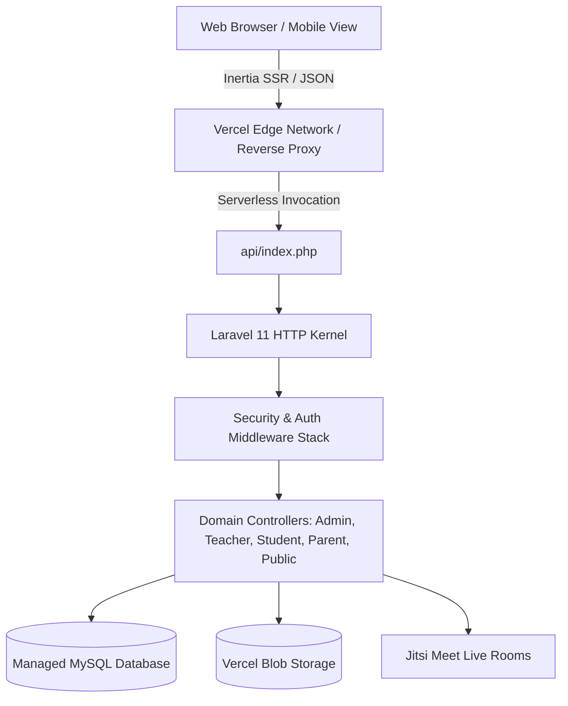

# System Architecture & Baseline Audit

**Platform:** Al-Tafawwuq Educational System (منصة التفوق التعليمية)  
**Target Curriculum:** State of Qatar (منهج وزارة التعليم والتعليم العالي القطرية - الصفوف 1-12)  
**Audit Date:** 2026-10-16  
**Auditor / Roles:** Principal Software Architect, Senior Full-Stack Engineer, QA Automation Engineer, DevOps & Security Engineer  

---

## 1. System Overview & Technology Stack

The platform is a multi-tenant-like private educational SaaS serving students, teachers, parents, and administrative staff across Qatar. It provides group tutoring, 1-on-1 private tutoring, learning management (curriculum units, lessons, materials, quizzes, worksheets), attendance tracking, live sessions via Jitsi Meet integration, and payment verification workflows.

### 1.1 Core Components & Runtime Stack
- **Backend Framework:** Laravel 11.x (PHP 8.2+ compatibility; currently running PHP 8.5 on dev/staging)
- **Frontend Architecture:** Inertia.js (Single Page Application architecture with server-driven routing)
- **Client Framework:** Vue 3 (Composition API, `<script setup>`, Reactive State)
- **Build Tool:** Vite 6 with Vue & Laravel plugins
- **Database Engine:** MySQL 8.0+ / MariaDB 10.4+ in production; SQLite supported for in-memory automated test execution
- **Caching & Sessions:** Redis / Database driver for distributed serverless session and cache synchronization
- **Deployment Platform:** Vercel Serverless PHP Runtime (`vercel-php`) with Edge Network distribution
- **Video & Live Classroom:** Jitsi Meet integration with room access token authorization
- **Bot Protection & Security:** Cloudflare Turnstile CAPTCHA on public authentication and registration forms

---

## 2. Platform Architecture & Data Flow

### 2.1 User Roles & Authorization Boundaries
1. **Admin / Supervisor (`admin`):**
   - Full system governance, curriculum management, teacher approvals, payment receipt verification, audit log review, grade assignments.
2. **Teacher (`teacher`):**
   - Group management, rosters, gradebooks, question bank, worksheet submissions, schedule management, live interactive sessions.
3. **Student (`student`):**
   - Grade-locked curriculum browsing, enrolled group workspace, assessments, homework submissions, schedule view, live class participation.
4. **Parent (`parent`):**
   - Read-only oversight of linked students' academic progress, attendance, grades, and upcoming scheduled live classes.

---

## 3. Initial Baseline State & Confirmed Technical Gaps

Prior to this audit cycle, several structural, deployment, and logic issues existed in the codebase:

1. **Vercel Serverless Routing Issue (HTTP 404 on API endpoints):**
   - `api/index.php` explicitly assigned `$_SERVER['SCRIPT_NAME'] = '/api/index.php'`. Symfony's `Request::prepareBaseUrl()` interpreted `/api` as the base directory and stripped it from incoming requests, causing `/api/search-autocomplete` and `/api/cron/*` to 404 in production.
2. **LiveSession Relationship Defect:**
   - Model `LiveSession` defined `teachingGroup()`, but `Teacher/DashboardController` queried `LiveSession::with(['group.assignment...'])`, triggering `RelationNotFoundException` and breaking the teacher dashboard with a 500 error.
3. **Test Student Data Consistency Defect:**
   - In `database/seeders/TestAccountsSeeder.php` and the database, student `student@almagd.com` was seeded with `grade_level = 'الصف العاشر'` (Arabic string) rather than the normalized lookup key `grade_10`. This broke curriculum unit resolution, subject loading, and group assignments.
4. **Brittle QA Selectors:**
   - Playwright end-to-end tests used fragile pseudo-selectors like `button.nth(2)` in `Login.vue`, causing intermittent test failures during automated CI runs.
5. **Dangerous Unconditional Production Migrations:**
   - `scripts/vercel-migrate.php` previously executed `migrate --force` automatically on serverless invocation without requiring explicit operational opt-in.
6. **Package Release Security Gaps:**
   - No automated build verification script existed to guarantee release archives were sanitized of `.env` files, sqlite databases, private storage, or logs.
