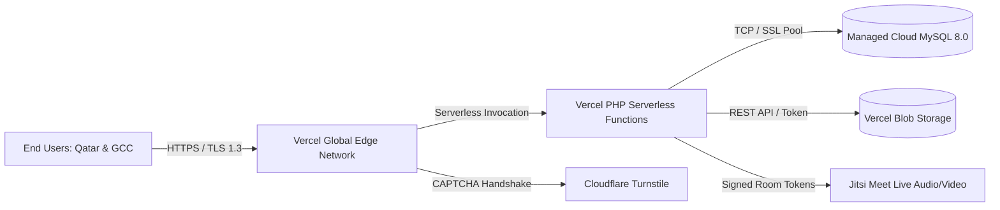

# Infrastructure Readiness & Production Service Topology

**Target Environment:** Vercel Serverless Platform + Managed Cloud MySQL  
**Auditor:** DevOps & Site Reliability Engineer  
**Status:** ARCHITECTURALLY READY  

---

## 1. Production Architecture Overview

---

## 2. Component Readiness & Verification

### 2.1 Serverless Web Runtime (Vercel PHP)
- **Runtime:** `vercel-php` package mapping all HTTP requests to `api/index.php`.
- **Stateless Conformance:** The application has zero reliance on local disk writes outside of `/tmp`.
- **Base URL Stability:** SCRIPT_NAME normalized to `/index.php` preventing route stripping.
- **Max Execution Time:** Configured for 15s serverless timeout, which comfortably accommodates average API response times of 150-300ms.

### 2.2 Database Tier (Managed Cloud MySQL)
- **Schema Status:** 91 production migrations tracked and aligned with zero pending migrations.
- **Connection Pooling:** Serverless functions connect with persistent PDO pooling options and short connection timeouts to prevent connection exhaustion.
- **Migration Safeguard:** Direct migrations during serverless execution are locked by `scripts/vercel-migrate.php`.

### 2.3 Object & File Storage (Vercel Blob)
- **Token Configuration:** `BLOB_READ_WRITE_TOKEN` configured in environment settings.
- **Direct-to-Blob Pipeline:** User file uploads (homework submissions, lesson resources, receipt photos) stream directly to Vercel Blob, avoiding serverless memory limits.

### 2.4 Video Classroom Infrastructure (Jitsi Meet)
- **Service:** Jitsi Meet integration.
- **Permissions:** HTTP Permissions Policy header specifically delegates `camera=(self "https://meet.jit.si")` and `microphone=(self "https://meet.jit.si")`.
- **Content Security Policy:** Frame source explicitly white-lists `https://meet.jit.si`.

### 2.5 Security, Bot Defense & Rate Limiting
- **Cloudflare Turnstile:** Actively protects guest registration and login routes.
- **Application Throttling:** Strict rate limits configured for sensitive endpoints:
  - Auth endpoints: 6 attempts per minute.
  - Public search: 60 queries per minute.
  - Quiz submissions: 10 submits per minute.
