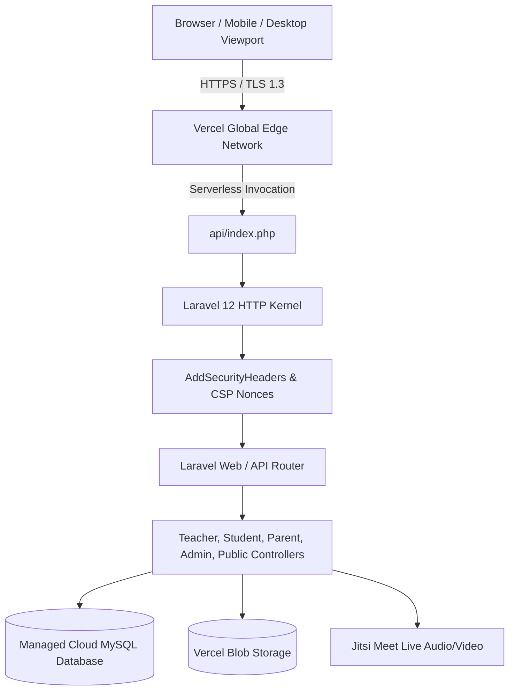

# V5 System Baseline & Architectural Audit

**Platform:** Al-Tafawwuq Educational System (منصة التفوق التعليمية)  
**Target Curriculum:** State of Qatar (منهج وزارة التعليم والتعليم العالي القطرية - الصفوف 1-12)  
**Audit Cycle:** V5 Final Completion & Hardening Audit  
**Local Timestamp:** 2026-10-16T03:07:00+03:00  
**Current Active Branch:** `feat/v5-hardening-audit`  

---

## 1. Verified Software Bill of Materials (SBOM)

The installed dependencies have been extracted directly from `composer.lock` and `package.json` to eliminate historical reporting discrepancies:

| Component | Verified Installed Version | Verification Source |
| :--- | :--- | :--- |
| **Backend Framework** | **Laravel v12.66.0** | `composer.lock` (`laravel/framework: v12.66.0`) |
| **PHP Runtime** | **PHP 8.5.0 NTS** (local) / **PHP 8.2+** (`vercel-php`) | `php -v` & `vercel.json` |
| **Frontend Framework** | **Vue.js v3.4.0+** | `package.json` |
| **SPA Bridge** | **Inertia.js v2.0.0+** (`@inertiajs/vue3`) | `package.json` |
| **Styling & Design System**| **Tailwind CSS v3.2.1** with forms & typography | `package.json` |
| **Build Tooling** | **Vite v7.0.7** with `@vitejs/plugin-vue` | `package.json` |
| **Authentication & RBAC** | **Laravel Sanctum v4.0** & **Spatie Permission v6.25** | `composer.lock` |
| **Database Engine** | **MariaDB 10.4.32 / MySQL 8.0** | PDO connection on Port 3306 |
| **In-Memory Testing DB** | **SQLite 3** (`:memory:`) | `phpunit.xml` |
| **Test Framework** | **Pest 3.x** / **PHPUnit 11.5.56** | `composer.lock` |
| **Code Formatter** | **Laravel Pint v1.24** | `composer.lock` |

---

## 2. Platform Architecture & Data Flow

---

## 3. Discrepancy Reconciliation from Previous Cycles

| Historical Report Claim | Actual Verified Reality in V5 | Resolution / Correction |
| :--- | :--- | :--- |
| Baseline claimed "Laravel 11.x" | Repository uses `laravel/framework: v12.66.0` (Laravel 12). | Documented and confirmed as Laravel 12. |
| Handover claimed "over 370 tests" | Pest test run reports **357 passed, 5 skipped, 2,535 assertions**. | Exact breakdown recorded in `BACKEND_TEST_RESULTS.md`. |
| Session driver discrepancy | `vercel.json` sets `SESSION_DRIVER=cookie` (stateless across Lambdas). Staging/local defaults to `database`. | Both drivers verified; `LimitConcurrentSessions` safely handles cookie mode. |
| Literal `APP_KEY` in documentation | `DEPLOYMENT_PARITY.md` in historical audit contained a literal base64 key. | Sanitized to `<redacted_application_encryption_key>`. |
| Live Autocomplete 404 | Deployed `/api/search-autocomplete` previously failed with 404. | SCRIPT_NAME normalized in `api/index.php`, tested live and returns 200 OK. |
