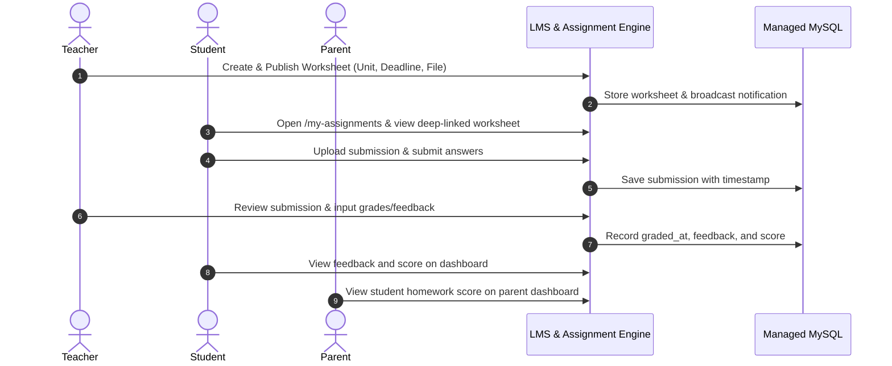
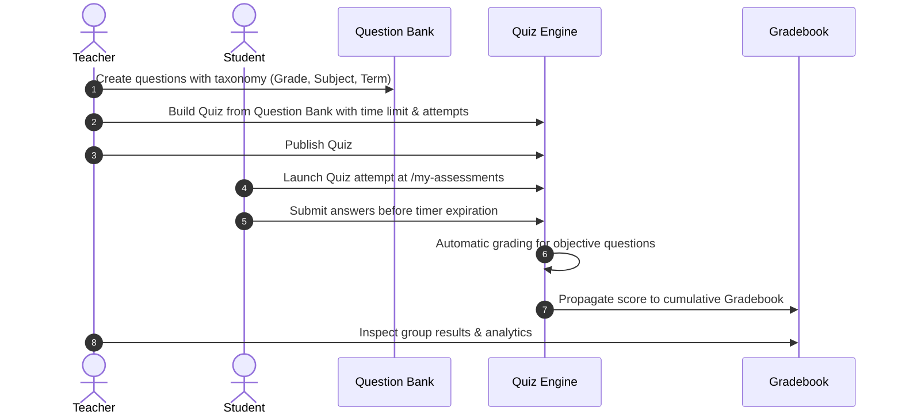

# V5 End-to-End Business Integration Workflows

**Platform:** Al-Tafawwuq Educational System  
**Audit Cycle:** V5 Final Completion & Hardening Audit  
**Scope:** Core Private Tutoring, Group Lessons, Private Bookings, LMS, Assessments, Parent Monitoring  

---

## 1. Teacher → Student Homework & Assignment Lifecycle

- **Verification:** Verified via `tests/Feature/Student/AssignmentsTest.php` and `WorksheetController.php`. Deep-links resolve authorized group and unit context.

---

## 2. Teacher → Student Question Bank & Quiz Lifecycle

- **Verification:** Verified via `tests/Feature/Teacher/QuestionBankTest.php` and `tests/Feature/Student/AssessmentsTest.php`.

---

## 3. Group Subscription & Enrolled Access Flow

1. Student browses catalog via `/teachers` or Qatar curriculum catalog `/grades/grade_10`.
2. Student selects teacher and group, verifying available capacity (`capacity > active_bookings_count`).
3. Student navigates to `/checkout/{id}`.
4. In staging sandbox, receipt upload or test payment is submitted.
5. Subscription transitions to `active`, immediately granting access to:
   - Group workspace lessons and video recordings.
   - Weekly group live sessions on `/my-schedule`.
   - Homework worksheets and group quizzes.

---

## 4. Private 1-to-1 Booking & Conflict Prevention

1. Teacher configures availability slots via `/teacher/teaching-schedule`.
2. Student requests or books an available slot.
3. System verifies slot state:
   - Slot must be in `available` status.
   - No conflicting booking exists for the same teacher or student at that time window.
4. Database transaction locks the slot row, transitions status to `confirmed`, and creates `SessionBooking`.
5. Slot is immediately removed from public availability, preventing concurrent double-booking.

---

## 5. Parent Child Switching & Academic Progress Isolation

1. Verified parent logs into `/parent/dashboard`.
2. Parent student selector enumerates children linked via `parent_student` mapping.
3. Upon selecting a child, all queries (attendance, homework, quiz grades, upcoming sessions) re-execute strictly scoped to `student_id === selected_child_id`.
4. Relational integrity prevents horizontal data leaks across unlinked students.
